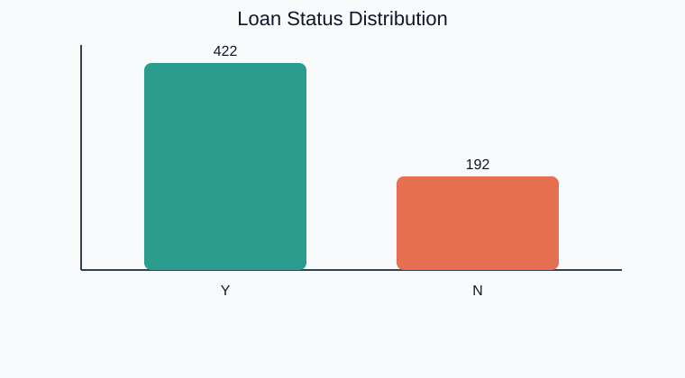
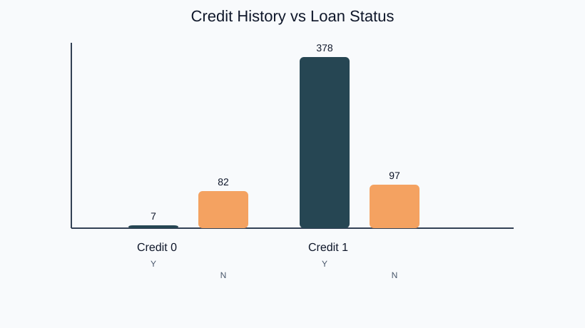
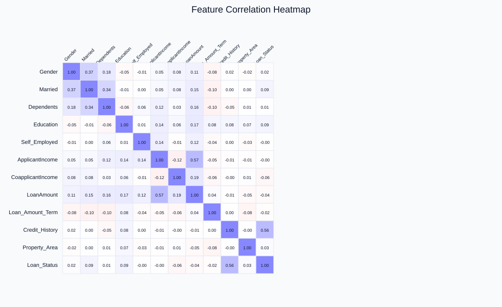
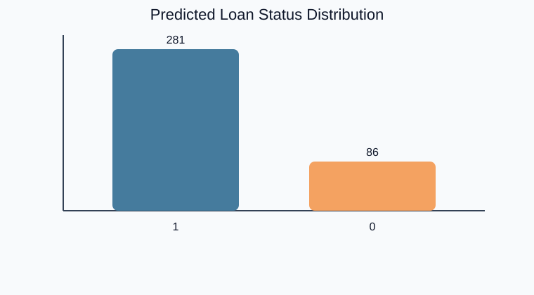

# Loan Prediction Classification & Underwriting Dashboard

A machine learning project and interactive underwriting intelligence dashboard that predicts whether a loan application will be approved (`Y`) or rejected (`N`) based on applicant profile, income, credit history, and property details.

## Project Summary

This repository contains an end-to-end classification workflow and interactive web dashboard built around the classic loan approval dataset. The pipeline follows:

1. Load the training and test datasets
2. Clean missing values and apply robust feature imputation
3. Encode categorical variables into numeric form
4. Explore feature relationships with correlation plots and distribution analysis
5. Benchmark 8 classification models with 10-Fold Stratified Cross-Validation
6. Provide an interactive Streamlit Underwriting Platform with real-time eligibility simulation
7. Generate batch predictions on test applicants

The final prediction file is saved as [`output.csv`](output.csv).

## Business Goal

The goal is to estimate loan approval decisions automatically so that financial teams can make faster, more consistent screening decisions, calculate borrower risk tiers, and identify key drivers of default.

## Dataset

The dataset is stored in [`Dataset/`](Dataset/):

- [`train.csv`](Dataset/train.csv) - labeled training data (614 applications)
- [`test.csv`](Dataset/test.csv) - unlabeled test data used for prediction (367 applications)
- [`Sample_Submission.csv`](Dataset/Sample_Submission.csv) - reference submission format

### Target Variable

- `Loan_Status`
  - `Y` (1) = loan approved
  - `N` (0) = loan rejected

### Main Features

- `Loan_ID`
- `Gender`
- `Married`
- `Dependents`
- `Education`
- `Self_Employed`
- `ApplicantIncome`
- `CoapplicantIncome`
- `LoanAmount`
- `Loan_Amount_Term`
- `Credit_History`
- `Property_Area`

## Interactive Web Dashboard

The project features a **Streamlit & Plotly Underwriting Platform** (`app.py`):

1. **📊 Executive Portfolio KPIs**: Real-time metrics on approval rates (68.7%), average loan amount ($146,412), median applicant income, and property regional breakdowns.
2. **🎯 Real-Time Loan Eligibility Simulator**: Enter applicant demographic and financial details to receive:
   - Instant decision verdict (`APPROVED` / `REJECTED`)
   - Model confidence gauge and risk tier classification (Prime, Near-Prime, High Risk)
   - Estimated monthly EMI and Debt-to-Income / EMI ratio
   - Factor audit highlighting positive credit drivers and risk warnings
   - One-click JSON assessment report download
3. **📈 Exploratory Data Analytics (EDA)**: Interactive correlation matrix, scatter plots of Income vs Loan Amount with approval status, loan term distributions, and demographic breakdowns.
4. **⚖️ Model Benchmark Arena**: 10-fold cross-validated comparison across 8 classification algorithms (Logistic Regression, Linear Discriminant Analysis, SVC, Random Forest, Gradient Boosting, Decision Tree, KNN, Naive Bayes), interactive confusion matrix, feature importance rankings, and sensitivity threshold tuning.
5. **📂 Batch Scoring & Dataset Explorer**: Live evaluation of the 367 test applications, search and filtering by status/property area, custom CSV uploader for batch scoring, and CSV export.

### Launching the Dashboard

```bash
# Install dependencies
pip install -r requirements.txt

# Launch the Streamlit dashboard
streamlit run app.py
```

*On Windows, you can also double-click `run_dashboard.bat`.*

## Visualizations

### Loan Status Distribution



### Credit History vs Loan Status



### Feature Correlation Heatmap



### Predicted Loan Status Distribution



## Project Files

- [`app.py`](app.py) - Streamlit web dashboard application
- [`ml_engine.py`](ml_engine.py) - modular ML engine, ensemble training, metrics, and inference pipeline
- [`run_dashboard.bat`](run_dashboard.bat) - Windows launcher script
- [`requirements.txt`](requirements.txt) - Python dependencies
- [`Loan+Prediction.ipynb`](Loan+Prediction.ipynb) - main exploratory notebook
- [`Loan+Prediction.py`](Loan+Prediction.py) - notebook export script
- [`output.csv`](output.csv) - final predictions
- [`assets/`](assets/) - visual summaries used in this README

## Tech Stack

- Python 3.10+
- Streamlit
- Plotly
- scikit-learn
- pandas
- NumPy
- seaborn
- matplotlib
